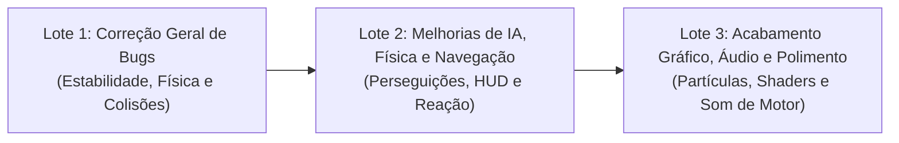

# 🔍 Diagnóstico Técnico e Plano de Ação - Projeto Hacker ctOS (São Francisco DedSec)

> **Auditoria de Código-Fonte e Estabilidade para GitHub Pages**  
> **Tecnologias:** Vanilla JavaScript (ES Modules), Three.js 0.160.0 (CDN), Web Audio API, Zero dependências externas / Zero assets locais.  
> **Data:** Novembro de 2026.

---

## 1. 🐛 Lista Real de Bugs Encontrados no Código Atual

Esta auditoria varreu exaustivamente os módulos `script.js`, `js/state.js`, `js/world.js`, `js/entities.js`, `js/combat.js`, `js/ui.js`, `js/audio.js` e `js/network.js`. Abaixo estão os bugs reais e latentes catalogados por área funcional.

---

### A. Terreno, Água, Pontes e Relevo

1. **Teleporte Vertical do Jogador ao Nadar Sob as Pontes**
   - **Arquivo:** `js/entities.js`
   - **Função:** `updatePlayer()` (linhas ~1793–1805)
   - **Causa Raiz:** O bloco que detecta se o jogador está sobre as pistas elevadas da Golden Gate (`z: 26.5..43.5`, `x: 78..402`) e da Ponte Sul (`z: 312..328`, `x: 78..402`) avalia exclusivamente as coordenadas $X$ e $Z$, sem checar a altura $Y$. Quando o jogador está nadando ou boiando sob a ponte ($Y \approx -1.15$), a condição `onElevatedBridge` é avaliada como `true`, desativando a natação (`isSwimming = false`) e interpolando `pos.y` para $10\,\text{m}$ ou $7\,\text{m}$, teletransportando o jogador magicamente da água para o asfalto elevado no ar.
   - **Correção:** Exigir `pos.y >= bridgeHeight - 2.5` para considerar `onElevatedBridge = true`.

2. **Assincronia de Limites $Z$ da Golden Gate entre Detecção de Terreno e Elevação**
   - **Arquivo:** `js/state.js`
   - **Função:** `getSurfaceHeight(x, z)` vs `isWaterForLand(x, z)`
   - **Causa Raiz:** A pista da Golden Gate foi construída centrada em $Z=35$ com largura $18\,\text{m}$ (intervalo real $Z \in [26, 44]$). Em `isWaterForLand` o intervalo de exceção para carros é $Z \in [26, 44]$, porém em `getSurfaceHeight` a verificação usa `z >= 26.5 && z <= 43.5`. Se um carro ou pedestre trafegar na margem lateral da pista ($Z \in [26, 26.5)$ ou $Z \in (43.5, 44]$), `getSurfaceHeight` retorna `0`, fazendo o veículo ou jogador afundar instantaneamente no mar no meio da ponte.
   - **Correção:** Equalizar os limites da Golden Gate em `getSurfaceHeight` para $Z \in [26.0, 44.0]$.

3. **Inconsistência de Retorno de Altura na Borda da Baía e Píeres**
   - **Arquivo:** `js/state.js`
   - **Função:** `getSurfaceHeight(x, z)`
   - **Causa Raiz:** Ao avaliar a baía ($X \in [76, 402]$), a checagem de píer em `isPierArea(x, z)` retorna $Y = 0.5$ para os píeres oeste ($X \le 82$) e leste ($X \ge 396$). No entanto, se o jogador saltar do píer para a beirada da rampa, não há interpolação suave até o nível da água ($Y = 0$), resultando em pequenas quedas bruscas de física vertical.

---

### B. Colisões e Física

4. **Drone DedSec Atravessa Andares Superiores dos Edifícios Abertos**
   - **Arquivo:** `js/world.js`
   - **Função:** `buildEnterableBuilding()`
   - **Causa Raiz:** Na construção dos prédios abertos (Complexo ctOS, Edifício Corporativo, etc.), o térreo possui paredes com colliders cadastrados, mas o bloco da torre superior (`upperMesh`, acima de $Y = 4.6\,\text{m}$) não é registrado na lista global de `colliders`. Como `checkDroneCollision(pos, radius)` em `js/state.js` testa colisão contra `colliders`, o Drone ($Q$) voa livremente através das paredes sólidas dos arranha-céus acima do térreo.
   - **Correção:** Registrar a `Box3` da torre superior em `colliders` (com metadado ou bounds apropriados).

5. **Tetos e Marquises das 3 Lojas Comerciais sem Colisão Vertical**
   - **Arquivo:** `js/world.js`
   - **Função:** `buildStores()`
   - **Causa Raiz:** Os tetos e marquises das lojas DedSec Style, SF Motors e HackShop Armory foram gerados com `{ collide: false, occlude: false }`. Jogadores que saltam de prédios vizinhos ou o Drone que desce sobre as lojas caem através do teto diretamente no balcão interno sem qualquer resistência física.
   - **Correção:** Ativar colisão no teto das lojas adicionando a `Box3` correspondente em `colliders`.

6. **Projéteis não Colidem com Veículos NPC nem Viaturas Policiais**
   - **Arquivo:** `js/combat.js`
   - **Função:** `updateProjectiles()` e `updateGuardProjectiles()`
   - **Causa Raiz:** Tiros disparados pelo jogador ou guardas detectam colisão apenas contra `guards`, `pedestrians` e o carro pilotado pelo jogador (`gameState.drivingCar`). Viaturas policiais em perseguição e carros do tráfego comum são totalmente imunes a disparos, e as balas passam direto pelas suas carrocerias sem impacto ou detonação.
   - **Correção:** Adicionar verificação de colisão e dano veicular contra `policeCars` e `cars`.

---

### C. IA, Guardas, Polícia e Civis

7. **Guardas Miram e Atiram no Chão ($Y=0$) quando Jogador está Elevado**
   - **Arquivo:** `js/entities.js`
   - **Função:** `updateGuards()` (linhas ~2592 e ~2596)
   - **Causa Raiz:** Ao perder a linha de visão direta, o código atualiza `g.lastKnownPos` fixando $Y=0$: `new THREE.Vector3(playerPos.x, 0, playerPos.z)`. Se o jogador estiver no Mirante Twin Peaks ($Y = 11.5\,\text{m}$) ou nas pistas elevadas da Golden Gate ($Y = 10\,\text{m}$), os guardas em alerta miram seus cones de visão e atiram para baixo, atingindo o solo abaixo das estruturas.
   - **Correção:** Preservar a cota de elevação real `playerPos.y` em `g.lastKnownPos`.

8. **Waypoints de Reforço Policial Gerados na Cota Zero ($Y=0$)**
   - **Arquivo:** `js/entities.js`
   - **Função:** `disembarkPoliceCar()`
   - **Causa Raiz:** Ao desembarcar policiais da viatura, o segundo waypoint passado para a rota tática é instanciado como `[pPos.x, 0, pPos.z]`. Caso a perseguição ocorra em uma ponte ou aclive do Distrito Sul, os policiais recém-desembarcados tentam navegar para o nível do mar através do asfalto elevado.
   - **Correção:** Obter a cota correta via `getSurfaceHeight(pPos.x, pPos.z)` para compor os waypoints dos reforços.

9. **Câmeras de Segurança Ignoram o Blackout Geral ($B$)**
   - **Arquivo:** `js/entities.js`
   - **Função:** `updateSecurityCameras()` (linha ~2348)
   - **Causa Raiz:** O método `updateSecurityCameras()` força `camObj.laserMesh.visible = true` incondicionalmente a cada frame, sobrescrevendo a desativação disparada em `triggerBlackout()`. Com isso, durante um Blackout geral ativado pela tecla $B$, os lasers das câmeras voltam a acender no frame seguinte e continuam detectando o jogador e acionando o alarme.
   - **Correção:** Adicionar verificação `if (gameState.blackoutTimer > 0) { camObj.laserMesh.visible = false; return; }` no loop de atualização das câmeras.

10. **Hitbox de Projéteis Falha em Estruturas Elevadas ou na Água**
    - **Arquivo:** `js/combat.js`
    - **Função:** `updateProjectiles()` e `updateGuardProjectiles()`
    - **Causa Raiz:** A validação de acerto testa intervalos verticais fixos: `p.pos.y >= 0 && p.pos.y <= 2.2` para guardas e `p.pos.y >= 0 && p.pos.y <= 2.0` para pedestres. Em `updateGuardProjectiles`, checa `gp.pos.y >= 0.1 && gp.pos.y <= maxPlayerY`. Em áreas elevadas (Mirante Twin Peaks $11.5\,\text{m}$, Pontes $10\,\text{m}$ e $7\,\text{m}$, lojas $0.19\,\text{m}$) ou na água ($-1.15\,\text{m}$), esses testes falham categoricamente e nenhum tiro acerta o alvo.
    - **Correção:** Fazer o teste de colisão vertical relativo à altura real da entidade: `Math.abs(p.pos.y - entityCenterY) <= entityHalfHeight`.

11. **Atordoamento de Pedestre Teletransporta o Modelo para a Cota Zero**
    - **Arquivo:** `js/combat.js`
    - **Função:** `updateProjectiles()` (linha ~375)
    - **Causa Raiz:** Ao atordoar um pedestre (taser/disparo não-letal), o código força `hitPed.mesh.position.y = 0.2`. Se o pedestre estiver em uma calçada alta, praça elevada ou mirante, seu corpo cai e afunda no asfalto até a cota $0.2\,\text{m}$.
    - **Correção:** Ajustar para `hitPed.mesh.position.y = getSurfaceHeight(hitPed.mesh.position.x, hitPed.mesh.position.z) + 0.2`.

---

### D. Missões, Lojas, HUD e Reset

12. **Modal de Loja Aberto não Libera o Cursor (Pointer Lock Preso)**
    - **Arquivo:** `js/ui.js`
    - **Função:** `openShopModal()`
    - **Causa Raiz:** Enquanto `openMissionModal()` executa `document.exitPointerLock()` para permitir que o jogador clique nos botões de aceitar missão com o mouse, `openShopModal()` omite essa chamada. O jogador entra na loja comercial, o painel de compras abre, mas o mouse continua travado no centro da tela e invisível.
    - **Correção:** Chamar `if (document.pointerLockElement) document.exitPointerLock();` em `openShopModal()`.

13. **Reset de Missão não Limpa Estados de Pânico e Chamadas ao ctOS dos Pedestres**
    - **Arquivo:** `js/world.js`
    - **Função:** `resetWorldState()`
    - **Causa Raiz:** Ao reiniciar uma missão ou morrer, `resetWorldState()` não reseta as propriedades `panickedTimer`, `stunnedTimer` e `callingPolice` dos pedestres. Se um pedestre estiver ligando para a polícia no momento da morte do jogador, ao reaparecer no checkpoint a polícia é acionada instantaneamente sem o jogador ter feito nada.
    - **Correção:** Iterar pelo array `pedestrians` em `resetWorldState()` e zerar timers e flags de denúncia.

14. **Reset de Missão não Restaura Armas e Estado de Natação se Morto na Água**
    - **Arquivo:** `js/world.js`
    - **Função:** `resetWorldState()`
    - **Causa Raiz:** Se o jogador for eliminado enquanto nada na baía, `gameState.isSwimming` permanece `true`, a ondulação aquática `refs.playerParts.swimRipple` continua visível e a arma no coldre permanece oculta (`weaponMount.visible = false`). Ao renascer em terra firme, o jogador surge desarmado e se movimentando como se estivesse nadando.
    - **Correção:** Forçar `gameState.isSwimming = false`, ocultar `swimRipple` e reexibir a arma do jogador em `resetWorldState()`.

15. **Vitória na Missão do Carro VIP Mantém Jogador Preso no Veículo Entregue**
    - **Arquivo:** `js/ui.js` e `js/world.js`
    - **Função:** `triggerVictory()` e `returnToFreeRoam()`
    - **Causa Raiz:** Ao entregar o veículo do contrato VIP na Garagem Clandestina, a função `triggerVictory()` exibe a tela de vitória mas não invalida `gameState.drivingCar`. Ao clicar em "Continuar no Modo Livre", o jogador reaparece em modo livre com a câmera e estados dessincronizados dentro do veículo que já havia sido entregue.
    - **Correção:** Executar `toggleDriveDedsecCar()` ou desvincular explicitamente `gameState.drivingCar = null` antes de consolidar a vitória.

16. **Disparo Indevido de Armas Dentro da Lancha**
    - **Arquivo:** `script.js`
    - **Evento:** `mousedown` (linha ~208)
    - **Causa Raiz:** O evento de clique para atirar valida `if (!gameState.drivingCar)`, omitindo a flag `gameState.drivingBoat`. O jogador consegue disparar projéteis invisíveis de dentro da cabine da lancha enquanto navega a toda velocidade na baía.
    - **Correção:** Alterar a checagem para `if (!gameState.drivingCar && !gameState.drivingBoat)`.

17. **Objetivo do HUD Dessincronizado em Missões com Múltiplos Portões**
    - **Arquivo:** `js/ui.js`
    - **Função:** `completeTerminalHack()`
    - **Causa Raiz:** Ao hackear o primeiro portão de acesso nas Docas da Baía SF, o código avança o estado para `STEAL_DATA` e altera o texto do HUD para "BAIXE OS DADOS NO SERVIDOR", mesmo que o segundo portão ainda esteja trancado e exija um segundo hack.
    - **Correção:** Validar se todos os portões de acesso foram violados antes de avançar a legenda do HUD para o roubo de dados.

---

### E. Performance e Erros de Runtime

18. **Excesso de PointLights Ativas na Cena (Violação do Limite de 8)**
    - **Arquivo:** `js/world.js`
    - **Função:** `buildExtractionZone()`
    - **Causa Raiz:** O motor gráfico Three.js com shaders móveis/WebGL padrão tem um limite recomendado de performance de até 8 `PointLight` ativas. O jogo já instancia 7 luzes pontuais contínuas (`activeHeadlight`, `streetNeonCyan`, `streetNeonMagenta`, `gateEntryLight`, `courtyardLightLeft`, `courtyardLightRight`, `serverLight`). A função `buildExtractionZone()` instancia uma nova `PointLight(0x00ff88, 1.8, 12)` para cada zona de extração criada (Complexo ctOS e Docas), elevando o total para 9 luzes ativas simultâneas.
    - **Correção:** Reutilizar uma única `PointLight` global para a zona de extração ativa ou substituir a luz por um shader pulsante emissivo no anel cilíndrico sem custo de luz dinâmica.

19. **Falta de Null-Check em Rotação do Servidor e Anéis de Extração**
    - **Arquivo:** `js/entities.js`
    - **Função:** `updateInteractionsAndMission()`
    - **Causa Raiz:** O loop de frame tenta acessar propriedades `.rotation.y` e `.scale.set()` diretamente em `refs.serverCoreMesh` e `refs.extractionRing`. Em contratos livres (ex: roubo de carro VIP nas colinas), essas malhas não são criadas, disparando exceções intermitentes de `TypeError: Cannot read properties of null` no console.
    - **Correção:** Adicionar validação estrita `if (refs.serverCoreMesh)` e `if (refs.extractionRing)` antes de manipular as transformações.

20. **Vazamento de Memória GPU (Geometrias e Materiais) em Carros e Reforços Policiais**
    - **Arquivo:** `js/entities.js` e `js/world.js`
    - **Função:** `spawnFleeingDriver()`, `resetWorldState()`
    - **Causa Raiz:** Ao despawnar pedestres em fuga, viaturas policiais destruídas ou reiniciar a cena em `resetWorldState()`, os nós são removidos da árvore do Three.js (`scene.remove(mesh)`), porém suas geometrias (`BufferGeometry.dispose()`) e materiais (`Material.dispose()`) não são liberados. Em sessões longas de jogo no navegador, a memória WebGL se acumula continuamente.
    - **Correção:** Implementar função utilitária `disposeHierarchy(obj)` para limpar geometrias e materiais ao remover entidades temporárias da cena.

---

## 2. 🚀 Backlog de Melhorias de Alto Impacto

Abaixo estão 16 melhorias práticas e concretas para elevar o nível de jogabilidade, imersão audiovisual e fluidez no GitHub Pages:

1. **Shader Procedural de Ondulação com Reflexo Especular da Baía de SF:**
   Elevar o realismo visual da água adicionando reflexos especulares solares/lunares e normais procedurais com leve movimento senoidal nos vértices da malha aquática sem impacto em FPS.
2. **Efeito Sonoro Dinâmico e Partículas de Splash ao Entrar na Água:**
   Gerar efeito de borrifo de água via partículas brancas procedurais e som de mergulho via sintetizador Web Audio API quando o jogador, carro ou lancha entrar na baía.
3. **Buzina Veicular Funcional com Reação de Pedestres:**
   Adicionar tecla de buzina ($H$ / Shift no veículo) que emite som sintetizado e faz pedestres próximos correrem para a calçada e saírem da frente do carro.
4. **Indicador de Diferença de Nível (Setas Cima/Baixo) no Minimapa Radar:**
   Adicionar pequenas setas $(\blacktriangle / \blacktriangledown)$ sobre os marcadores de guardas e objetivos no minimapa quando o alvo estiver em cota vertical diferente do jogador (ex: viadutos, pontes ou mirante).
5. **Transição de Câmera Suave (Lerp Orbit) ao Trocar 1ª e 3ª Pessoa ($P$):**
   Suavizar a transição da câmera com interpolação esférica ao alternar entre o modo ombro e o modo cockpit de veículos e a pé, evitando cortes secos de viewport.
6. **Faróis Dianteiros com Projeção Conectada em Viaturas Policiais:**
   Adicionar cones de luz volumétrica simples e faróis sincronizados com as sirenes piscantes nas viaturas policiais em perseguição.
7. **Marcador de Trajetória e Alerta de Granada para Guardas:**
   Exibir indicador visual de área de explosão vermelha no solo quando um guarda arremessar granada ou armar armadilha ctOS, dando janela de reação tática ao jogador.
8. **Feedback Visual de Dano Direcional no HUD (Hit Indicator):**
   Adicionar arco avermelhado translúcido no centro da tela apontando para a direção de onde vieram os disparos inimigos recebidos.
9. **Modo Noturno / Dia Automático ou Hack ctOS de Horário:**
   Possibilitar hackear a rede de iluminação da cidade para forçar o entardecer neon ou a madrugada escura, alterando o tom da névoa e a intensidade dos neons.
10. **Comportamento de Tráfego com Parada em Semáforos:**
    Fazer os carros do tráfego civil pararem diante de semáforos vermelhos fechados pelo hack de semáforo do jogador, provocando engavetamentos táticos contra viaturas perseguidoras.
11. **Som Procedural de Motor Dinâmico para Veículos e Lanchas:**
    Modular a frequência e oscilador do Web Audio API com base na velocidade real do carro (`car.speed`) e da lancha, gerando feedback auditivo de aceleração realista.
12. **Linha de Mira Tática em Terceira Pessoa:**
    Exibir pequeno ponto laser ou retículo dinâmico que se ajusta à distância do impacto do tiro com leve dispersão ao atirar em movimento.
13. **Painel de Diagnóstico de Performance (FPS / Draw Calls / Memória):**
    Adicionar atalho de depuração ($F2$) para exibir um micro painel no canto com FPS estável, número de geometrias ativas e draw calls para testes de benchmark.
14. **Checkpoints Dinâmicos nas Missões Longas:**
    Salvar estágios concluídos de missões complexas (ex: portão aberto, servidor hackeado) para evitar que o jogador precise reiniciar a infiltração do zero caso seja abatido na fuga.
15. **Suporte Completo a Gamepad / Controle Bluetooth:**
    Mapear eixos de analógicos e botões (gatilhos para aceleração/tiro, analógico para câmera e direção) via Gamepad API nativa do navegador sem bibliotecas externas.
16. **Exportação / Importação de Save State no LocalStorage:**
    Permitir que o jogador preserve seus créditos DedSec, armas compradas no HackShop e missões concluídas no `localStorage` do navegador com botão de backup/reset.

---

## 3. 📋 Plano de Execução em Lotes Pequenos

Para garantir estabilidade absoluta e validação contínua no navegador sem quebrar o código existente, a execução é dividida em 3 lotes modulares:

---

### 🔹 Lote 1: Correção Geral de Bugs (Estabilidade, Física e Colisões)
*Foco: Eliminar todos os 20 bugs identificados na Seção 1, garantindo física sólida, missões sem travamento e ausência de erros no console.*

- [ ] **1.1. Geometria e Física de Pontes e Água:**
  - Corrigir detecção de pontes elevadas em `updatePlayer()` adicionando verificação de cota $Y$, impedindo teleporte ao nadar sob as pontes.
  - Sincronizar o intervalo $Z \in [26.0, 44.0]$ da Golden Gate em `getSurfaceHeight()` com `isWaterForLand()`.
  - Corrigir limites de altura em píeres e rampas para transição suave até o mar.
- [ ] **1.2. Colisões do Drone e Lojas Comerciais:**
  - Incluir as torres superiores (`upperMesh`) dos 4 edifícios abertos no registro de `colliders` para que o Drone não as atravesse.
  - Adicionar colisão sólida nos tetos e marquises das 3 lojas comerciais em `buildStores()`.
  - Bloquear disparos de arma ao pilotar lanchas (`gameState.drivingBoat`).
- [ ] **1.3. IA, Altura de Mira e Blackout:**
  - Manter a cota $Y$ real do jogador em `g.lastKnownPos` e waypoints policiais em aclives, mirante e pontes.
  - Fazer as câmeras de segurança respeitarem o Blackout geral (`gameState.blackoutTimer > 0`), mantendo lasers apagados.
  - Ajustar o cálculo de hitbox de projéteis em `js/combat.js` para entidades em cotas verticais elevadas ou na água.
  - Garantir que a posição de pedestres atordoados respeite a altura do piso via `getSurfaceHeight()`.
- [ ] **1.4. Fluxo de Missões, Lojas e HUD:**
  - Adicionar `document.exitPointerLock()` em `openShopModal()` para liberar o mouse ao acessar as lojas.
  - Limpar timers de pânico e denúncia dos pedestres em `resetWorldState()`.
  - Restaurar estado de natação, armas no coldre e ondas aquáticas em `resetWorldState()`.
  - Desvincular `gameState.drivingCar = null` ao consolidar vitória no contrato VIP de veículos.
  - Ajustar texto de objetivo do HUD para exigir abertura de todos os portões antes do download de dados.
- [ ] **1.5. Limpeza de Recursos e Performance:**
  - Reduzir `PointLight` da zona de extração para reutilização de instância única, respeitando o teto de 8 luzes pontuais.
  - Inserir null-checks defensivos em `refs.serverCoreMesh` e `refs.extractionRing`.
  - Implementar descarte de geometrias e materiais (`dispose`) ao remover viaturas e motoristas em fuga.

---

### 🔹 Lote 2: Melhorias de IA, Física e Navegação
*Foco: Elevar a inteligência de perseguição, direção veicular e qualidade da navegação.*

- [ ] **2.1. Perseguição Policial e Colisão Veicular:**
  - Fazer viaturas policiais perseguidoras e carros civis registrarem caixas de colisão contra projéteis balísticos e impactos.
  - Adicionar faróis volumétricos simples com alternância de luzes vermelhas/azuis nas viaturas da polícia.
- [ ] **2.2. Reação de Pedestres e Trânsito:**
  - Implementar buzina de veículos ($H$ / Shift) com reação sonora e dispersão de pedestres nas ruas.
  - Adicionar parada de carros do tráfego em semáforos fechados por hack.
- [ ] **2.3. Navegação Tática e HUD:**
  - Adicionar setas de elevação $(\blacktriangle / \blacktriangledown)$ nos ícones de inimigos e objetivos no minimapa radar.
  - Exibir indicador direcional de dano no HUD ao ser alvejado.
  - Suavizar a transição da câmera ao alternar 1ª e 3ª pessoa ($P$).

---

### 🔹 Lote 3: Acabamento Gráfico, Áudio e Polimento Geral
*Foco: Imersão sensorial, áudio procedural dinâmico e retenção de progresso.*

- [ ] **3.1. Efeitos Visuais Aquáticos e Atmosféricos:**
  - Refinar o shader procedural de água da baía com reflexo especular dinâmico e ondas mais suaves.
  - Adicionar partículas de splash e borrifo ao entrar ou acelerar na água com barcos ou a pé.
- [ ] **3.2. Áudio Procedural Dinâmico:**
  - Sintetizar som dinâmico de motor automotivo e náutico modulado por velocidade e rotação via Web Audio API.
  - Adicionar som de splash aquático ao saltar na baía.
- [ ] **3.3. Persistência e Otimizações de Deploy:**
  - Integrar salvamento de progresso de contratos e armas desbloqueadas no `localStorage`.
  - Adicionar atalho de diagnóstico ($F2$) para monitoramento de FPS e memória.
